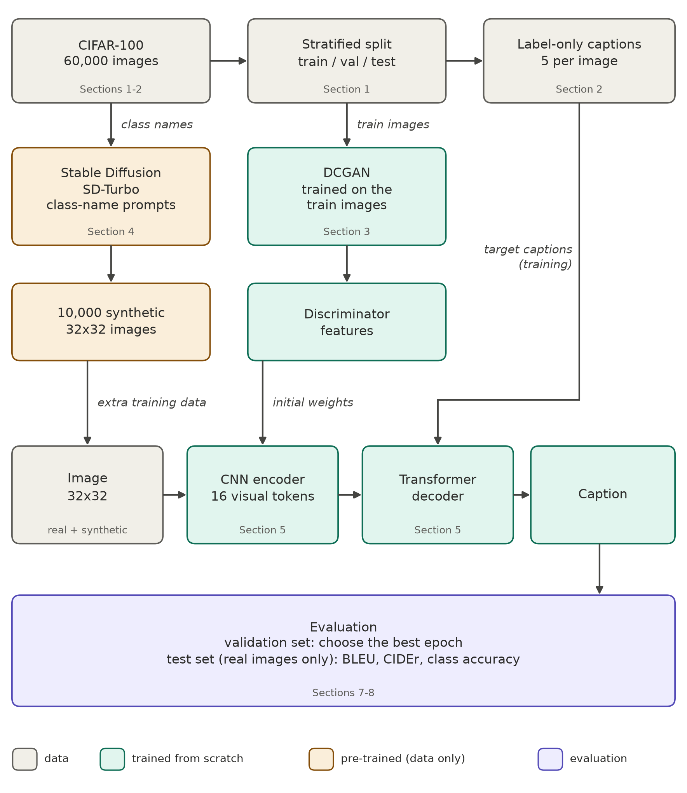

# Image Captioning on CIFAR-100, built from scratch

A model that looks at a small 32×32 picture and writes a short caption such as "a photo of a maple tree".
The captioner (CNN encoder + Transformer decoder with attention) is trained from scratch in PyTorch.
Two generative models help it: a **DCGAN** whose discriminator initialises the image encoder, and **Stable Diffusion** (`sd-turbo`, pre-trained) which only creates extra training images.

## Pipeline

## Results (test set, 12,000 real images)

| Encoder | Training data | Fine accuracy |
|---|---|---|
| random init | real | 51.8% |
| DCGAN init, fine-tuned | real | 57.2% |
| DCGAN init, fine-tuned | real + Stable Diffusion | **57.5%** |

The DCGAN encoder is the main gain. Stable Diffusion adds little. The notebook has the full tables, example captions and error analysis.

## How to run

1. Open `image_captioning_cifar100.ipynb` (locally or in Google Colab with a GPU runtime) and choose **Run all**.
2. Set `TRAIN_DCGAN` and `TRAIN_CAPTIONERS` in Section 0 to `True` to retrain, or leave them `False` to load the saved models from `checkpoints/`.
3. The 10,000 Stable Diffusion images are generated once (about 30 minutes on one GPU) and cached in `data/`. Set `GENERATE_SD = False` in Section 4 to skip that step.

Requirements: `torch`, `torchvision`, `numpy`, `pandas`, `matplotlib`, and `diffusers`, `transformers`, `accelerate` (only needed to generate the Stable Diffusion images; Colab installs them automatically).

## Files

| Path | Content |
|---|---|
| `image_captioning_cifar100.ipynb` | all code, results and discussion |
| `checkpoints/` | trained DCGAN and captioner weights |
| `outputs/` | figures and `results.json` |
| `data/` | CIFAR-100, the saved split and the synthetic images (not tracked by git) |
